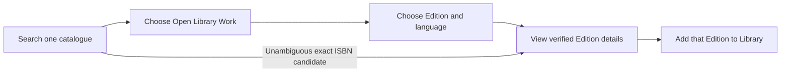

# Book Search V2 - Open Library-first decision and Phase 2A archive

**Current decision: Phase 2B implementation authorized by the owner on 1 November 2026; live activation, saving, push and deployment remain unauthorized.** Baseline HEAD is `084a1d17062d3f317370eb5b608d302c71f64947`.

Open Library is the intended primary book-discovery provider. Google Books is an explicit, separate secondary option. Never merge results or automatically fall back between catalogues. Preserve existing Google Volume IDs, detail routes, Library records and personal/list identities. The earlier recommendation to retain Google as the long-term default is superseded.

The implementation is read-only and remains operationally gated. Until activation is authorized, the frontend defaults to the functional Google Books view and Open Library's separate view explains the gate without sending search requests. After prerequisite confirmation and owner authorization, the public build switch `VITE_OPEN_LIBRARY_DISCOVER_ENABLED=true` makes Open Library the implicit default; the existing private backend activation remains a separate requirement. No actual environment or hosting setting has been changed.

The bounded edition flow inspects and lets the user choose only the one Edition supplied by the existing search projection. It does not implement the archived proposal's edition catalogue, extra routes, exhaustive language coverage or saving. Newest is absent from the controls pending validation. Google discovery now keeps provider order and all candidates, shows a language caveat instead of local omissions, and supplies the official powered attribution and prominent book links.

See [Phase 2B implementation, activation blockers and validation](BOOK_SEARCH_V2_PHASE2B_IMPLEMENTATION.md) for the exact shipped scope, URL/flag contracts, limiter behavior, Hostinger evidence requirements and remaining persistence work. This decision does not assert superior catalogue coverage, live availability, policy clearance or independent browser acceptance.

## Preserved Phase 2A proposal - historical, superseded where different

The owner's pre-existing uncommitted proposal follows intact. Its optional-preview/default recommendation, draft API/UX, old Google behavior, pending-implementation labels and historical validation describe **31 October**, not the current implementation. These details remain useful evidence and future design input; the current decision above and linked Phase 2B report take precedence. In particular, the proposed edition-list/Work/detail endpoints below are **not implemented**.

---

# Book Search V2 — Phase 2A decision and UX specification

**Status: proposed; owner approval required before implementation.** Reviewed on 31 October 2026 against HEAD `084a1d17062d3f317370eb5b608d302c71f64947`. This document changes no application behavior or approved architecture. No provider API requests, registration, environment changes, database operations or deployment were performed. Official documentation and the registration form were read only.

## 1. Recommendation and confidence

Keep the existing Google Books experience and saved-volume resolver in place while resolving the policy issue below. Prepare an **optional, separately presented Open Library preview** using **Search → Work → Edition/language → Details → Add to Library**. Introduce saving only after its separate acceptance gate. Do not replace the default provider, blend result sets, auto-fallback on errors or manufacture a cross-provider Work identity.

| Decision | Recommendation | Confidence and limit |
| --- | --- | --- |
| Current default | Retain Google Books pending an approved change; preserve every existing volume ID | High confidence in compatibility; this is not a finding that the current UI satisfies all provider policies |
| New discovery model | Evaluate Open Library Work cards with explicit edition choice | Moderate confidence in usefulness from the existing samples; low confidence in comparative accuracy, coverage or long-term availability |
| Saved Open Library identity | `open-library` / `book` / validated `OL…M` Edition ID | High confidence that this fits the current per-record tracking model; requires new resolver/validator/UI support |
| Default-provider replacement | Defer until policy, hosting, sampling and UX gates pass | Evidence is insufficient today; keeping the default after a preview remains a valid outcome |

Google-only discovery is the lowest-change option but leaves the observed edition repetition and language omissions. An Open Library default switch now would depend on unverified catalogue and hosting behavior. The proposed explicit preview permits comparison without changing saved identities or concealing which catalogue supplied a record.

**Material Google policy issue:** the official [branding guidelines](https://developers.google.com/books/branding), still linked by the API documentation, prohibit reordering returned results, require search attribution and prominent book links, and restrict competing search logos on the same page. Current `rankBooksByTitle()` reorders Google candidates; the selected-language guard also omits candidates. This is a documented conflict/review issue, not a legal-compliance verdict. Resolve ranking/filtering applicability and attribution before approving a redesigned Google path. Do not assume existing tests, plain-text credit or the age of that official page establish permission. This phase leaves the implementation untouched. The [Books terms](https://developers.google.com/books/terms) also require separate consideration if charging for the application is planned.

## 2. Evidence and provider assessment

The [existing evaluation](BOOK_SEARCH_V2_PROVIDER_EVALUATION.md) contains the detailed query tables; the [Search V1 QA follow-up](DISCOVER_SEARCH_V1_QA_FOLLOWUP.md) records the earlier upstream-language investigation and remaining browser acceptance. The following evidence labels distinguish observations from proposals:

| Evidence | Scope and limitation |
| --- | --- |
| [E1: 30 October snapshot](evidence/book-search-v2-2026-10-30.json) | 27 Google and 21 Open Library searches, plus detail/cover reads. Short, unequal request mixes from one execution host; metadata-based assessments, not an independently labelled benchmark |
| [E2: Open Library extension](evidence/book-search-v2-phase01-network-2026-10-31.json) | 12 network requests: 11 nonempty successes and one successful empty response; invalid ISBN rejected locally. 73 returned card occurrences, including repeats |
| [E3: Google extension](evidence/book-search-v2-phase01-google-2026-10-31.json) | First three searches returned 503; the predefined stop rule prevented the remaining comparisons. No successful matched comparison for the expanded corpus |
| [E4: sandbox transport attempts](evidence/book-search-v2-phase01-2026-10-31.json) | Twelve connection failures with no provider HTTP response. Execution-environment failures, not observed Open Library downtime |
| Current code/tests | Deterministic normalization, identity, cache, error and limiter behavior. Fixtures do not establish live availability or catalogue correctness |

### Verified observations and UX implications

| Area | Google Books observation | Open Library observation | Implication / missing evidence |
| --- | --- | --- | --- |
| General search | E1 G01–G04 find the intended Hobbit/Dune novels and Potter books, with repeated volume editions | E1 OL01–OL04 find the intended Works; Potter has all seven core novels in the first seven positions | Work grouping can broaden a first screen, but these are different result units and not comparable catalogue totals |
| Title search | Explicit `intitle:` probes succeed in some samples; the earlier QA had genuine empty responses and later probes had transient 503s | Explicit title probes succeed but also return related works. E2 Home starts with *Fun Home*, *At Home* and *Miss Peregrine's Home for Peculiar Children* | Title mode is not exact-title matching. Retain author, subtitle/format context and provider order for assessment |
| Author search | G05/G06 broad search mixes works by/about Le Guin; explicit author probes G12/G13 list her as author | OL05/OL06 and explicit probes put familiar Le Guin Works first | Author mode is useful. Neither provider's ranking proves popularity or exclusive authorship |
| ISBN | G07 plain number is empty; G14 explicit ISBN is 503; G24 later resolves volume `Ts_gmPmzxtUC` with the exact ISBN | OL14/OL18 resolve Edition `OL10236414M`; E2 ISBN-10/13 both select that Edition | Explicit ISBN intent and edition verification are needed. One successful ISBN does not measure coverage |
| Duplicate records / adaptations | Multiple Tolkien volumes occupy slots; guides, braille and graphic editions occur | Hobbit results include an adaptation/set; E2 has five *The Vet's Daughter* Work records and multiple Turkish title groups | A Work is a provider grouping, not a deduplicated story guarantee. Never merge by normalized title |
| Mismatched associations | G01 volume `hgufNAAACAAJ` labels ISBN `9780261103566` as a braille Hobbit | OL01 associates that ISBN with a Hobbit/Lord of the Rings set; OL04 Work `OL19618275W` selects *House Harkonnen* (`OL7830092M`) | Even an ISBN or Work association can conflict. Show both levels and block known contradictory selections; do not pick a winner without verification |
| Authors / missing data | E1 broad cards have authors on 59/60 occurrences | E1 authors on 60/61 Works; sparse `OL19659526W` lacks author/language/ISBN/cover in the relevant search projection | Missing author is a visible state, not evidence of an invalid Edition ID |
| Covers | E1 broad cards have 53/60 cover locators | E1 has 60/61 Work cover locators and 59/61 selected-edition cover IDs | Four cover transport probes succeeded across providers; correctness and visual quality were not inspected. Always support placeholders |
| Publication / completeness | G24 reports `1996` and 302 pages for the tested ISBN | OL18 reports `2011` and no page count for that ISBN; E2 collection query has a Work with no selected Edition | Preserve date precision, provenance and work-versus-edition labels. This disagreement has no established authoritative winner |
| Errors / empties | E1: 18 nonempty successes, two empty successes, seven 503s; E3: three additional 503s before stopping | E1: 20 nonempty successes and one empty success; E2: 11 nonempty successes and one empty success | HTTP errors, transport failures and locally omitted candidates are distinct from provider-empty responses |
| Latency | E1 successful-search median 838 ms, maximum 1,428 ms | E1 successful-search median 731 ms, maximum 4,077 ms; E2 range 787–2,799 ms | Different cases/times and success-only timings; no supported speed or reliability winner |

These are verified **response observations**, not verification of book contents. E2's author/year/cover/ISBN completeness counts and full request parameters remain in the linked evaluation instead of being duplicated here. Descriptions/pages not requested in a projection are unmeasured, not automatically missing.

### Edition-language accuracy

| Existing probe | Google raw volume tags | Open Library selected-edition tags | Interpretation |
| --- | --- | --- | --- |
| English Hobbit | G25: 6/10 `en` despite the restriction | OL15: 10/10 `eng` | Tag alignment differs in this sample; actual content language was not independently checked |
| Dutch Hobbit | G16: 0/10 `nl` | OL16: 9/9 `dut` | Current Google defensive filtering would omit the sampled candidates; this does not prove Dutch editions are absent |
| Turkish Hobbit | G17: 0/10 `tr` | OL17: 6/6 `tur` | Same qualification; no long-term or complete-catalogue accuracy estimate |
| Dutch preference only | No equivalent preference-only Google control | OL21 and E2 preference control: one Dutch selected edition among ten; others mismatched/unknown | Preference must not be labelled a strict filter |
| Suspected metadata conflict | Provider tags can be incorrect even when syntactically valid | OL10 Edition `OL61068165M` has a Polish-looking title but tag `eng` | Record as a suspected conflict requiring independent verification; a translated title alone does not prove content language |

**Assumptions to validate:** an extra edition-choice step helps users pick the intended language/format; users understand independent catalogue records; Hostinger can sustain coordinated lookup. **Missing evidence:** successful expanded Google comparisons, independent content-language/relevance judgements, actual cover correctness, multi-day data, edition pagination behavior on the intended host, and usability tests of the proposed flow. No superior-provider claim follows from the samples.

## 3. Official API constraints

Official sources were consulted on **31 October 2026**. Documentation reads are separate from provider API traffic; example API links were not executed.

| Source | Verified contract fact / consequence |
| --- | --- |
| [Google API guide](https://developers.google.com/books/docs/v1/using) | Volume IDs and explicit title/author/ISBN operators; application identification uses a key or OAuth. Current optional-key code is not evidence that anonymous production usage is approved |
| [Google volume list](https://developers.google.com/books/docs/v1/reference/volumes/list) | `langRestrict`, relevance/newest, `printType`, pagination and a maximum 40 results. Provider-reported totals are not the count returned |
| [Google Volume resource](https://developers.google.com/books/docs/v1/reference/volumes) | Volume identity and edition-like metadata; not an exposed Open Library-style Work grouping. Do not cache personalized `userInfo` |
| [Open Library Search API](https://openlibrary.org/dev/docs/api/search) | Work results can include a selected Edition. `lang` influences selection; a language query constrains matches. Schema stability is not guaranteed |
| [Open Library Work/Edition APIs](https://openlibrary.org/dev/docs/api/books) | Separate Work, work-edition collection, Edition and ISBN lookup routes. The ISBN route can redirect; current transport deliberately does not follow redirects |
| [Official edition-list implementation](https://github.com/internetarchive/openlibrary/blob/master/openlibrary/plugins/openlibrary/api.py) (`get_editions_data`) | Source inspection shows `limit`/`offset`, `entries`, `size` and continuation links. This is source evidence, not confirmation of the deployed API version or response reliability |
| [Open Library covers](https://openlibrary.org/dev/docs/api/covers) / [licensing](https://openlibrary.org/developers/licensing) | Direct public cover-host URLs and a courtesy backlink; no cover crawling. Existing rights may remain. A locator is not verified edition artwork |

Future Google queries must use the owner's configured, appropriately restricted identification, without logging credentials. Future Open Library queries must satisfy the readiness gates in section 7. Do not introduce automatic ISBN redirect following: keep the existing ISBN search path first; any future redirect support needs a separate same-host, bounded-hop design and budget accounting.

## 4. UX decision and detailed behavior

### Approaches considered

| Approach | Benefits | Costs and risks |
| --- | --- | --- |
| A. Edition-first results with immediate Add | Familiar current Google flow; fewer steps; concrete record on every actionable card | Repeats editions; a selected Open Library Edition can look authoritative although it is incomplete/wrong. Enumerating editions for every result creates request fan-out |
| B. Work-first results, then a dedicated edition page **(recommended for the Open Library preview)** | Clear grouping and language/format choice; one bounded edition-list request after a human chooses a Work; preserves separate identities | Extra step; duplicate/bad Works remain; bounded lists cannot promise every edition or language |

Use A for the existing Google catalogue and B for the optional Open Library catalogue. Present one catalogue at a time with a text-labelled switch, distinct result headings and provider-specific attribution. No mixed-result ranking or competing-logo layout is proposed. Branding review remains a release gate, including the Google ranking issue in section 1.



The ISBN shortcut still fetches/validates the actual Edition before enabling Add. Google volume results continue directly to their own volume detail route; they are never assigned an inferred Open Library Work.

### Search controls and submitted context

| Control | Proposed behavior |
| --- | --- |
| Catalogue | Default Google Books; Open Library preview appears only through a public server capability, after owner-approved enablement. Switching catalogue preserves a draft but does not issue two searches or silently fetch a fallback |
| Search in | All fields, Title, Author; explicit ISBN is a future addition. UI `all` maps to pilot `general`; ISBN normalizes spaces/hyphens and validates checksum. Do not silently reinterpret arbitrary numbers |
| Language | Any by default; English/Dutch/Turkish map to `eng`/`dut`/`tur` for Open Library. Selecting a language defaults the preview UI to **Only this language**, explicitly sending `strict`; **Prefer this language** is a separate choice sending `preferred` |
| Google language | Preserve awareness of current `langRestrict` plus local omission behavior; approve any revised filtering behavior only after the policy review. Do not invent a Google preference-only API equivalent |
| Sort | Existing Google relevance/newest semantics remain documented; Open Library preview initially offers Best match only, preserving provider order. Do not show an unsupported Newest control or a popularity claim |
| Requests | Open Library input and filter changes are drafts until Search/Apply. No per-keystroke, focus, hover, prefetch or background calls. Current Google immediate filter submission is not changed by this document |

Future URLs extend existing `/discover?q=…&type=book&field=…&lang=…&sort=…` context with `catalog=open-library` and, when meaningful, `languageMode=strict|preferred`. Omitted catalogue means Google Books. Never forward unsupported sort/field values to the pilot. Keep per-catalogue preferences; returning to Google restores its previous sort. Cache/deduplication keys must include catalogue, query, field, language, mode, sort and page/operation; drafts and submitted results remain distinct. Back/refresh restores the selected Work/edition context and scroll without changing saved identities. URLs/history contain no serialized results or account data.

### Cards, edition choice and details

| Surface | Required content and actions |
| --- | --- |
| Work card | Work title, Work authors or “Author not provided”, first-publication year, clearly representative cover, reported edition count, Open Library backlink. Primary **Choose an edition**; no Add button. Keep complete names/titles available without a hover-only disclosure |
| Selected-edition preview | Optional title/language/date below Work metadata, labelled “Suggested edition”. This is a candidate, not a chosen/saved identity. Show provenance when its cover/date differs from the Work |
| Work without valid selected Edition | In Any/Prefer mode, retain useful Work metadata with **Browse editions**. If none are usable, show “No usable edition in the checked results”, not “This book has no editions”. Permit read-only Work/source navigation; never save a Work ID |
| Edition page | Work context plus cards/rows showing edition title, language state, edition publication date, publisher/format/ISBN when available, and its own cover or placeholder. Display **View this edition**; no default selection based on cover, year or edition count |
| Edition detail | Chosen edition title and ID, explicitly separated Work title/first year, edition date precision, language state, available authors/roles, ISBNs and provenance. Add applies only to this Edition. A representative Work cover must not be presented as its confirmed cover |
| No matching page | “No verified English edition in these checked results” with explicit Any/Prefer and More editions actions when allowed. Strict mode must not display another language as a confirmed match |
| Duplicate Works | Retain different Work IDs even with identical titles/authors. Label adaptations/sets only when supported by metadata, not title heuristics. A reported edition count is not a count of unique stories or available languages |

The initial edition list inspects at most ten records per page and three pages (30 records) per Work/filter context. **More editions** is explicit; never automatically scan pages to fill a language filter. Preserve provider order within each page. Preference influences the search-selected preview; it does not imply that the Work's edition-list API supports language ranking. On the edition page, Prefer labels matching languages without hiding other candidates; Only filters the inspected page locally. Mark the list partial, report inspected versus eligible counts, and stop at the cap with direct ISBN search/source navigation. Work/Edition totals and pagination can change; do not promise a snapshot or complete language coverage.

On a normal search journey the Work header reuses the public search summary. A direct Work deep link without that summary first loads Work metadata; a separate **Show editions** action requests the first edition page. This avoids hidden two-request fan-out and makes the five-per-minute admission limit visible. Server busy/limit states can interrupt any step; do not silently increase that limit for the new UX.

### Language and selection eligibility

Retain the current `match`, `mismatch`, `unknown`, `ambiguous`, `inconsistent` and `unverified` distinctions. Matching tags mean **provider metadata matches**, not independently proven content language. Work language unions never substitute for an Edition's own language.

- Strict mode accepts only unambiguous matching selected-edition metadata. Unknown/multilingual/conflicting candidates cannot bypass it. Offer an explicit switch to Any/Prefer instead.
- In Any/Prefer mode, missing language/date/author/ISBN alone need not invalidate an otherwise verified Edition. Proposed policy: require an explicit warning acknowledgement before saving an Edition whose language or Work association is unverified. Owner approval of this policy is required.
- A direct Edition response must supply the requested `OL…M` ID and usable title. Invalid/mismatched IDs, missing title, or a known incompatible Work association block Add in that Work journey. Translated titles alone are not grounds for a mismatch verdict.
- If Work association is absent, a user may explicitly open standalone Edition details and acknowledge that no parent is verified; save only the Edition, with no invented Work link. A known conflict requires leaving the wrong Work context and reviewing the actual Edition independently. Navigation acknowledgements do not authorize client-supplied metadata: the server resolves the Edition itself.

For explicit ISBN search, verify that the actual Edition contains the requested checksum-valid ISBN. A validated ISBN-10/13 equivalence may be shown only when conversion is applicable and explicitly labelled; no fuzzy or title-only matching. A single verified candidate may skip the Work picker. Multiple candidates retain the edition chooser; missing/mismatched identifiers show “No verified edition for this ISBN” and offer explicit Title search. The suspicious `9780261103566` pair remains a review case, not a merge rule.

### Loading, error and navigation states

| State | Required feedback and recovery |
| --- | --- |
| Idle / loading | Explain the next step; one polite loading announcement and `aria-busy`; prevent repeated submission of the same pending action. New submitted context clears obsolete results; late responses cannot replace it |
| Provider empty | Valid success with zero upstream matches: “No results for this search”. Offer broadening only for active restrictions |
| Locally all omitted / partial | Show omitted invalid/language/ISBN counts for the bounded sample. Distinguish no eligible Editions from a provider-empty response; preserve already loaded successful pages if More fails |
| Client 429 | “Too many requests. Try again in N seconds” from safe `Retry-After`; allow manual retry after the interval. No automatic retry, quota workaround or automatic source switch |
| 503 / timeout | “The catalogue is temporarily unavailable”; preserve search context and cached navigation. Respect any retry interval. Do not label it empty or infer that every 503 is an upstream failure |
| Malformed data / invalid identity | Safe failure, no fabricated selectable record and no Add; explicit retry or another search |
| Disabled preview / saving unavailable | Explain that the preview or new saving is unavailable; retain the Google path and existing saved records. Discovery readiness does not imply saving readiness |
| Login / mutation failure | Preserve the public selection across login; account changes clear private feedback/caches. Existing membership/status/rating/list/Undo guards remain authoritative; errors must not manufacture a new Library entry |

Use native links/buttons and full pages rather than a nested modal picker. Every Choose/View/More/Retry action has an accessible name including its book context, visible focus and a 44×44 CSS-pixel target. On narrow screens use a single reading column, wrapped titles/authors and controls above the synopsis; nothing depends on hover, colour alone, swipe or horizontal scrolling. Avoid nested clickable cards/buttons. Announce result counts and omissions once via a polite live region. Move focus to the page heading on explicit forward navigation and restore it to the originating card/button on Back; do not steal focus on filter typing. Validate keyboard-only and screen-reader behavior plus 320×740, 390×844, 768×1024 and 1440×900 in Light/Dark. These are acceptance targets, not completed QA.

## 5. Identity and Library compatibility contract

| Entity | Proposed identity | May be saved? |
| --- | --- | --- |
| Existing Google volume | `google-books:book:<existing volumeId>` | Yes through the existing resolver; never rewritten |
| Open Library Work | `open-library:work:OL27482W` (discovery key only) | No; must never enter `media.source_id` as a book Edition |
| Open Library Edition | `open-library:book:OL10236414M` | Only after saving support/approval; `sourceId` is the Edition ID without `/books/` |
| Personal entry / list membership | Existing opaque `userMedia.id` / membership referencing that entry | Unchanged; never replace it with a provider or Work ID |

Open Library IDs must match the current pilot's separate W/M forms, positive numeric component and maximum total length 32. Preserve existing Google ASCII ID validation (1–191 allowed characters), legacy import behavior and all existing routes. An ISBN is metadata/search intent, not the saved key.

The future Add request keeps the existing identity-only shape:

```json
{"media":{"source":"open-library","mediaType":"book","sourceId":"OL10236414M"}}
```

The server resolves/caches authoritative public Edition metadata before its existing database transaction. It never trusts a Work title, cover, language, ISBN or parent supplied by the browser. Store verified Edition ID/title plus optional validated Work references and field provenance in `media.metadata`; `selectedEdition` in a search response is not an immutable saved selection. Preserve Work-first year and Edition date separately. Missing scalar values remain null and arrays empty; retain source paths, missing/invalid states and retrieval time. No metadata refresh may silently overwrite existing saved snapshots or change identities; catalogue corrections/redirect aliases need a separate reviewed policy.

The current schema uses source strings and JSON metadata rather than a provider enum. Its unique `(source, media_type, source_id)` and `(user_id, media_id)` constraints can represent coexisting sources without a migration merely to add `open-library`. This is a repository-based assessment, not a migration applied or real-database test. Work-level shared tracking, cross-provider links or persistent edition-switching would be additional schema/product decisions and are excluded from this proposal.

**Duplicates and personal state:** exact same-source Edition adds reuse the same media/owned entry, including concurrent requests. Different Editions of one Work may coexist as separate entries with independent `want-to-read`/`reading`/`finished` status and nullable 0.5–10 rating. A same-title, same-Work or cross-provider ISBN resemblance produces at most a nonblocking **possible duplicate** warning and an Open saved entry action; Keep separate requires deliberate user choice. Compare only already authorized Library metadata, with checksum checks and available author/language/format context; many old Google summary records have no ISBN, so absence of a warning is not proof of uniqueness. Never fetch a second provider automatically, merge entries, copy ratings/statuses or move Custom List memberships. Lists continue to reference each unchanged `userMedia.id`; existing removal/Undo behavior remains intact.

**Network/saving disabled after future saves:** existing entries must remain readable/editable/removable through authenticated Library/List APIs without a live provider call. Current `MediaDetailView` mounts Library controls only after public detail success; future support must decouple that condition. Reuse the authorized `GET /api/v1/library` snapshot and exact `mediaKey` to show “Saved metadata; live details unavailable” and existing controls. Render only fields that snapshot actually contains; a Library summary is not a complete live-detail response. Do not expose private account snapshots through a public detail endpoint. Public live details may remain unavailable while authenticated tracking still works. A separate saving capability must block new Open Library associations even when shared metadata is cached; exact existing associations remain idempotent. Google associations are unaffected.

## 6. Proposed Phase 2B API and implementation boundaries

All items below are **future contracts**, not routes/features available at HEAD except the existing search endpoint. Continue Vue 3, JavaScript and plain CSS; no new framework or automatic background service is needed.

| Surface | Proposed bounded behavior |
| --- | --- |
| Public catalogue capability | Advertise available book catalogues and separate Open Library discovery/saving capabilities, without secrets/contact details or a provider-health promise. Disabled discovery advertises no preview; saved-record support is independent |
| Existing `GET /api/v1/pilot/open-library/search` | Retain 1–10 results, first page only, existing field/language/omission contract; no replacement of existing Discover endpoints |
| New `GET /api/v1/pilot/open-library/works/{workId}` | One validated Work read; normalize only available metadata, no author/edition fan-out |
| New `GET /api/v1/pilot/open-library/works/{workId}/editions` | Fixed page size 10; allow offset 0, 10 or 20, plus validated language/mode. One upstream edition-list read per explicit page action; filter only that bounded page and report `inspected`, omission counts, nullable next offset and `truncated` |
| New `GET /api/v1/pilot/open-library/editions/{editionId}` | One validated Edition read; normalize ID/title, declared Work references, languages, dates, ISBNs, covers, publisher/format and provenance. Do not assume search-document arrays equal direct-Edition schemas |
| Future `GET /api/v1/media/book/open-library/{sourceId}` | Add only with approved canonical Edition support; reuse the same normalized Edition lookup/cache operation. Never accept W IDs or turn the current generic book resolver into a source-agnostic Google normalizer |
| Existing `POST /api/v1/library` | Extend source-specific validators/resolver after the saving gate; retain auth/CSRF, identity-only input, uniqueness, account ownership and response shape. Proposed saving capability defaults off independently of discovery |

Validate upstream pagination from official source/fixtures before release; do not trust or blindly follow arbitrary `links.next` URLs. Construct allowlisted Open Library paths/offsets locally. A single operation performs at most one upstream request; missing author names are shown as missing, not resolved with an N+1 loop. Search Work authors may remain labelled/provenanced Work authors; do not invent Edition contributors from author IDs.

Refactor the existing coordinator so **every** Open Library search, Work, edition-page, detail and authoritative save lookup uses the same provider budget, admission policy, cooldown and private inode. Preserve five admissions/rolling minute, provider-start spacing ≥1.1 seconds, 60-second failure cooldown, timeouts/body limits and no automatic retries. The usual cached-summary journey costs up to four admitted operations (Search, editions, detail, Add lookup); More/filter/retry actions can reach the limit and must show honest throttling.

Keep version-2 scheduling/client fields. Store operation-versioned, normalized public `provider/items` envelopes in the bounded cache, using distinct operation/ID/filter/page keys and validating payloads for each operation. This retains the current container shape while avoiding search/detail collisions; legacy search cache keys may expire unused. Do not put raw provider payloads or personal records into it. If implementation discovers an incompatible state change is necessary, require an explicit offline format-upgrade decision; never silently reset counters or budgets.

Concrete change areas: `OpenLibraryPilot`/adapters and bootstrap routes; backend `MediaRules`/source-aware resolver/detail handling; frontend `mediaIdentity.js`, provider services/detail field validation, Discover state/cache keys, Work/Edition views and provider-specific credits; Library membership/duplicate/snapshot presentation. `getMediaKey` already composes opaque source/type/ID values, but strict identity validation and detail source selection currently allow only one book source. Keep legacy-import validators separate. The schema, personal statuses, ratings and List membership model need no change for this Edition-identity proposal.

## 7. Policy and hosting readiness gates

The official [usage guidelines](https://openlibrary.org/developers/api) prioritize human lookup, ask for caching/identification and distinguish a default 1 request/second from an identified 3/second. They discourage generic third-party/high-traffic commercial backend use. The [linked registration form](https://docs.google.com/forms/d/1119CgdEWHtaAy2lOpUmtbe4S-w6xhJUin-nqP7Bl1XQ/viewform) requests application URL/description, contact, User-Agent, used services and application nature; it asks for single-IP use and explicitly says individual cases are not reviewed/approved. Registration is disclosure, not an SLA or permission certificate.

| Gate before any future live sampling/enablement | Required evidence; not performed in Phase 2A |
| --- | --- |
| Owner policy decision | Describe the actual personal/portfolio use, intended audience/traffic and proprietary package status accurately; do not claim an open-source licence that the repo has not adopted. Record why the intended lookup use fits. Commercial scale/monetization remains unresolved and may require a different arrangement |
| Registration and contact | Owner submits the official form only after approving the use case, chooses a real managed contact and actual application URL, and retains a private receipt/date. Match the configured MyFunList User-Agent to that declaration; keep contact out of Git/browser/errors. No submission or contact occurred here |
| Outbound topology | Verify the single actual Open Library egress IP and that no other worker/release/service bypasses the coordinator. Incoming client IP and outbound provider IP are different checks; do not rotate egress addresses to expand quota |
| Shared locks and persistence | On the intended PHP worker pool, demonstrate fixture-only competing requests share one canonical private file/inode and exclusive locks across workers and deploys. Verify private permissions, fsync/write failures, crash reservation and bounded storage. A CLI-only test does not establish PHP-FPM behavior; multi-host/unreliable filesystems need a genuinely shared coordinator |
| Client observation | Verify actual `REMOTE_ADDR` using controlled requests from known clients without logging raw addresses. Untrusted forwarded headers remain ignored. If a proxy hides clients, arrange an explicitly verified host configuration before relying on per-client fairness; no proxy trust is inferred here |
| State and secrets | Pre-provision the version-2 file outside both document root and release cleanup paths, with private directory/file permissions (recommended 0700/0600) and one stable ≥32-character `RATE_LIMIT_SECRET`. Initial state: `{"version":2,"nextRequestAt":0,"cache":[],"clients":[]}`. Existing v1 files fail closed; any upgrade is offline, preserving budget/cache and draining workers |
| Budget and rights | All metadata operations share the conservative current budget, including cached admission and future saves. Covers use returned CoverID URLs with ordinary on-screen lazy loading, no crawling. Preserve source credits/backlinks and review artwork rights; availability is not a rights clearance |
| Separate activation decision | Only the owner may authorize setting the existing pilot/shared-budget flags and later saving capability after these gates. Current staging verification deliberately requires the pilot to remain 404. A later preview activation requires an explicitly approved replacement verification plan, not removal of that check as routine cleanup |

No finite per-IP limiter prevents distributed clients, shared-NAT contention or storage saturation. Successful local fixture tests do not resolve those hosting constraints. Even after registration, Open Library may deny service; do not promise availability. Google attribution/ranking review remains a separate blocker for the proposed Google redesign and any broader provider-compliance claim.

## 8. Repeatable manual multi-day sampling protocol

**Planned only; no requests executed for this phase.** Run only after section 7 prerequisites and owner authorization, from one identified execution host/IP using the same shared budget. Use the owner's configured Google identification; never discover/extract a key from a deployed bundle for this protocol. Do not turn this into a cron task, monitor or automatic retry loop.

### Fixed corpus

Run one manually initiated session on Day 1, Day 3 and Day 7 at recorded, different local times. Freeze this corpus/version before Day 1; a change starts a separately labelled protocol revision, not an invisible replacement. Maximum ten raw results per search, first page only, provider default relevance. Submit explicit title/author expressions using the repository's frozen per-provider constructions, logging decoded public parameters. Do not compare provider totals as equivalent units.

| ID | Input / mode | Language intent | Review target, not an expected guaranteed result |
| --- | --- | --- | --- |
| C01 | Hobbit / general | Any | Tolkien novel; adaptations/sets in the tail |
| C02 | The Vet's Daughter / title | Any | Barbara Comyns; duplicate Work groups |
| C03 | De aanslag / title | Only Dutch | Harry Mulisch versus study material/other authors |
| C04 | Kürk Mantolu Madonna / title | Only Turkish | Sabahattin Ali; duplicate Works |
| C05 | Home / title | Any | Ambiguous title: exact titles distinguished from longer titles and unrelated works |
| C06 | Ursula Le Guin / author | Any | Works by the author versus books about her |
| C07 | 9780261103344 / ISBN | Any | Exact ISBN-13 Edition/Volume |
| C08 | 0261103342 / ISBN | Any | Same intended edition via ISBN-10; report IDs, do not force identity equality |
| C09 | The Hobbit / title | Any | Sparse `OL19659526W`, adaptations, companions; absence of that record is not automatically failure |
| C10 | The Great Dune Trilogy / title | Any | Collections and missing/unusable selected editions |
| C11 | Dune / general | Any | Original novel versus unrelated results; investigate suspected `OL19618275W` / `OL7830092M` association if returned |
| C12 | Hobbit / general | Only English | Selected-edition tag alignment, unknown/conflicting metadata |
| C13 | Hobbit / general | Prefer Dutch, Open Library only | Preference control; Google has no equivalent preference-only case, so no Google call or paired score here |
| C14 | myfunlist-no-such-book-20261031-x7q9 / general | Any | Distinguish genuine empty from errors |
| L01 | 9780261103345 / ISBN | Offline validation only | Invalid checksum must make zero network requests; not part of provider recall/reliability |

Use explicit `isbn:` for the planned Google ISBN cases (a research construction/future feature, not current UI auto-detection); retain actual Volume IDs. Open Library uses the adapter's ISBN field and literal-text query construction, two/three-letter mapping and explicit preference/strict distinction. Record raw candidates and locally eligible subsets separately. Freeze `printType=books` for Google; apply no application reranking to the provider benchmark. Any offline analysis of the old ranking helper is labelled separately and does not imply that deploying it is permitted.

### Bounds, pacing and stops

- At most **14 Open Library searches + 13 Google searches + four detail reads = 31 provider data requests per day**, **93 across three days**. No image probes, author/cover enrichment, catalogue scans, pagination or additional queries. L01 is offline and consumes no provider request.
- The four optional detail slots are fixed: Open Library Editions `OL10236414M` and `OL7830092M`; Google volumes `Ts_gmPmzxtUC` and `hgufNAAACAAJ`. Compare the known ISBN/date/association conflicts without assuming a winner. If a slot cannot be fetched safely, record it unexecuted; do not substitute another ID. A future bounded adapter/gateway for direct detail reads is a prerequisite for those slots; the current pilot exposes search only.
- One request at a time, at least **15 seconds after every response** before the next request, across both providers. All Open Library operations use the same admission/budget coordinator; do not bypass it with an uncoordinated script. This pace stays conservatively within five admissions/minute. Human/operator delays may be longer.
- No retries in a session. Stop that provider's session on 401/403/429, timeout, malformed/oversized data, or a client/storage/budget protection failure. Stop after at most three consecutive *known upstream* 5xx failures while advancing through the predefined cases, not repeating failures. If only a pilot 503 is available and its cause is unknown, stop immediately; do not assert it was an upstream response. Record all remaining slots as not executed.
- Do not probe limits, switch keys/IPs, alter nonce parameters, reset the state file or clear counters to obtain results. Do not rerun a failed day opportunistically. A stopped session is evidence, not permission to enlarge the request cap.
- Record cache hits separately. Do not count them as fresh network observations or clear shared state to force cold calls. Wait for ordinary TTL expiry before a session where practical; retain the actual cache outcome. Review existing cached/raw evidence without extra provider reads.

### Evidence schema and independent review

Each request slot records protocol/corpus version; repository commit and adapter version; UTC timestamp plus Europe/Amsterdam offset; provider/operation and decoded public parameters; requested field/language/mode/limit; identification-configured boolean (no contact/key); cache-hit/unknown and upstream-call count; HTTP/transport/local-error category; safe Retry-After; elapsed time and response bytes; reported total, raw returned count, eligible count and each omission reason. Record rank, Work/Edition/Volume IDs, titles, available authors, language tags, work first year versus edition date, checksum-valid ISBNs, cover locator presence/provenance, selected-edition association and missing fields. Preserve safe error categories without raw bodies/URLs containing credentials. Never record cookies, account IDs, secret hashes, raw IPs, contact details, full bundles or complete descriptions. Archive append-only, sanitized JSON with unique dates/session IDs; never overwrite E1–E4 or QA evidence.

Two reviewers who did not implement the ranking independently score the same provider-blinded top-five snapshots. Keep result-unit type (Work versus Volume) visible; hide provider names/branding/IDs during relevance scoring, then unblind for identity checks. No provider access is needed for scoring. Use this rubric before comparing findings:

| Dimension | Score / rule |
| --- | --- |
| Relevance | 3 = intended work (including editions/translations satisfying the stated intent), book by the requested author, or exact verified ISBN; 2 = clearly related item useful for the intent but not the target; 1 = guide/adaptation/about-author item outside the target; 0 = unrelated. For ambiguous C05, exact *Home* titles may score 3 regardless of author; containing the word alone does not |
| Identity safety | Valid ID kind; selected Edition belongs to the declared context or is explicitly unverified/conflicting; no Work-as-Edition substitution. Report failures separately from relevance |
| Language | Separate tag alignment from externally verified content language. Unknown/ambiguous stays unknown; title appearance alone cannot decide. Any independent publisher/catalogue reference must be logged with URL/date, with no extra provider API calls |
| Completeness | Presence/usable/missing/invalid for the fields actually requested. A cover locator is not correct artwork; text date presence is not date accuracy |
| Duplication / formats | Count repeated provider IDs separately from suspected duplicate stories, adaptations and collections. Do not deduplicate different Works/Volumes by title while scoring |

Preserve both independent scores and disagreements. An owner/adjudicator resolves disagreements against documented bibliographic references; unresolved cases remain unresolved. No single implementer's judgement is labelled independent QA.

Report, with denominators: successful nonempty/empty/error/transport/local-rejection/not-executed counts; fresh-network success fraction (valid nonempty or genuinely empty response / actual network attempts), with request-mix caveats; success/error latency separately (n, median, range); positive-query intended-hit@5 and relevance≥2 precision@5; exact ISBN match count; selected-edition tag alignment and unknown/conflict rates; completeness per requested field; duplicates/adaptations and suspected grouping failures. Hit@5 means at least one score-3 target among the first five returned candidates. Precision uses the actual returned top-five candidate count, with that denominator and short lists reported; an empty success is a hit miss with undefined precision. Keep per-query/provider/day results alongside aggregates; exclude C13 from paired comparison and C14/L01 from positive-query recall. After an error, relevance is unavailable/not assessable rather than zero. Do not derive uptime, content-language accuracy or a latency percentile/SLA from three small sessions.

Proposed progression criteria, subject to owner approval: no identity-kind substitution or silently selectable known-conflicting Edition; no unsupported-language item presented as a strict match; no protection bypass; a defensible top-five target for each named positive-title/author case on at least two of the three completed days, with every miss/empty/error retained; exact verified matches for both ISBN forms where success is claimed. A failure keeps the preview gated or narrows its claims; passing is evidence for another limited test, not public-launch readiness or an automatic provider-default switch.

## 9. Phase 2B roadmap and acceptance gates

No work below is authorized merely by this document. Approve the relevant owner decisions first; fixture-only development can then precede live readiness without enabling either flag.

| Work package | Concrete implementation work | Acceptance criteria |
| --- | --- | --- |
| B1. Approve contracts and fixtures | Freeze catalogue choice, Edition identity, eligibility/warnings, paging limits and capability/saving separation; add offline fixtures from preserved evidence | Separate W/M/Volume kinds, missing/ambiguous/conflicting metadata and exact ISBN cases represented; existing Google identity/routing fixtures unchanged |
| B2. Read-only gateway | Generalize the coordinator and typed cache; implement the proposed allowlisted Work/Edition routes and schema-aware normalizers | Disabled returns 404 before storage; every live lookup shares admission/global budget; one upstream call per operation; cache keys distinguish operations; no raw-URL following, per-result fan-out, DB/session dependency or provider calls in tests |
| B3. Work/Edition UX with fixtures | Add preview capability, dedicated pages, submitted context/cache keys, filter modes and state matrix; retain separate Google path | Work cannot Add; exact ISBN shortcut verifies Edition; Back/refresh/source switching preserve context; partial/empty/error/429 cases remain distinct; no hidden requests or stale/account-crossing feedback |
| B4. Host/policy and manual sampling | Owner completes section 7, then explicitly authorizes the section 8 protocol and reviews independent results | Registration is not called approval; actual worker locks/IP/budgets verified; fixed request cap/stop rules followed; no unsupported ranking/accuracy/reliability claim; default change remains a separate decision |
| B5. Separately gated saving | Extend strict source validators, source-specific authoritative resolver, identity-only Add and normalized detail; implement saved-snapshot fallback and possible-duplicate UX | Concurrent same-Edition Add is idempotent; Google IDs/metadata/statuses/ratings/list entry IDs unchanged; separate Editions track separately; editing/removal works with network/saving off; no client metadata authority or personal state in public caches |
| B6. Acceptance and rollout decision | Run existing plus focused frontend/backend suites, build/lint/Composer validation and approved independent browser QA | Keyboard/screen-reader and requested viewport/theme states verified; legacy and Google routes regressions pass; staging/HTTP results reported separately. Any DB-writing tests use only the existing guarded disposable loopback `myfunlist_test` setup. No production-data test or migration is inferred |

## 10. Owner decisions and release blockers

| ID | Decision / blocker | Recommended position |
| --- | --- | --- |
| O1 | Provider architecture/default | Approve separate optional Open Library preview; keep Google default. Decide later whether evidence justifies replacement |
| O2 | Google policy conflict | Resolve ranking/omission applicability, powered attribution and prominent book links before Google redesign or compliance sign-off; no further client reranking proposed |
| O3 | Unit of tracking | Approve Edition-level Open Library records alongside Volume-level Google records; independent ratings/statuses per record, no automatic cross-provider merge |
| O4 | Unverified metadata | Approve explicit acknowledgement for unknown language/Work association outside strict mode; block known conflicts in the selected Work context and missing/invalid Edition identity/title |
| O5 | Operational/policy suitability | Owner chooses truthful registration/contact/use case and verifies single-egress/worker locking/client IP/storage. No promise that registration ensures service or commercial suitability |
| O6 | Scope and evidence threshold | Approve the bounded picker, sampling rubric/progression criteria and separate saving gate. More exhaustive edition browsing, global popularity, Work-level tracking or alias migration require another decision |
| O7 | Publication/deployment | This documentation remains local for review. A push/deployment needs explicit approval; any future pilot activation must deliberately revise the currently required disabled-pilot staging check |

Until the relevant decisions and evidence gates are satisfied, Phase 2B implementation/activation is unapproved and the pilot remains disabled. Documentation validation passed repository/source cross-checks, evidence arithmetic, 19 internal links/fragments, the JSON request example and whitespace/fence checks. All four original evidence files are byte-identical to HEAD; the working-tree diff contains only this proposal and its `PROJECT_CONTEXT.md` link, with HEAD unchanged. Application tests, local preview, staging deployment, independent browser QA and provider availability sampling were not performed for Phase 2A.
